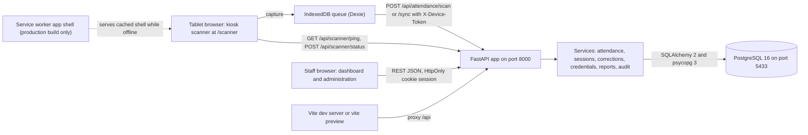
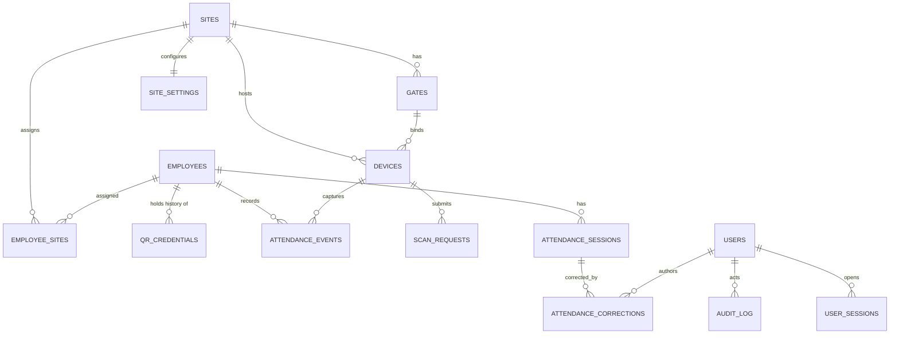

# Architecture

## Overview

The system is a single-origin web application. A React single-page app is served by Vite (port 3000 in development, port 4173 for the production preview) and proxies `/api` to a FastAPI backend on port 8000. The backend uses SQLAlchemy 2 with psycopg 3 against a repository-independent local PostgreSQL 16 cluster on port 5433. The schema is managed only by Alembic (`backend/migrations/versions/0001_initial.py` and `0002_gap_remediation.py`); there is no migration 0003 because no further schema change was needed. All data is synthetic and the dashboard shows recorded attendance status, not verified presence.



## Backend modules

`backend/app/main.py` builds the app, configures CORS from `CORS_ORIGINS`, installs the error envelope and request identifier middleware, adds a middleware that sets security headers and `X-Process-Time-Ms`, and mounts the routers under `/api`. Routers live in `backend/app/api/`: `auth`, `employees`, `credentials` (QR metadata and lifecycle), `sites` (sites, gates, devices, scanner context, ping and status), `scan` (scan and sync), `attendance` (dashboard, history, scan log, exceptions, corrections), `reports` and `admin` (permission matrix). `deps.py` holds the database session, the device guard and `require_permission`. Business rules are in `backend/app/services/`: `attendance` (scan and sync pipeline), `sessions` (on-site, daily, history, dashboard, status and flags), `corrections`, `credentials`, `reports`, `audit` and `monitoring`. Supporting modules are `config.py`, `permissions.py`, `db.py`, `crypto.py`, `security.py`, `clock.py`, `errors.py`, `models.py`, `schemas.py` and `seed.py`. Routers only validate, authorise and serialise; the rules stay in the services.

## Data model

Tables defined in `backend/app/models.py`: `sites`, `gates`, `site_settings`, `employees`, `employee_sites`, `qr_credentials`, `users`, `user_sessions`, `devices`, `scan_requests`, `attendance_events`, `attendance_sessions`, `attendance_corrections`, `audit_log`, `login_attempts` and `role_permissions`. Events and corrections are append-only by application convention. Partial unique indexes allow one open session per employee and site and one current (active or blocked) credential per employee; revoked credentials remain as history.



### Where the specification's suggested entities differ

The specification's entities map to the implemented tables as follows, and the differences are deliberate. A device is bound to a gate through `devices.gate_id`, so `gates.gate_code` and `gates.device_id` do not exist; gates are unique by name within a site. `attendance_events` has no `sync_status` or `event_status` column: a stored event is synchronised by construction, and the rejected, duplicate, conflicted, failed and pending states are kept in `scan_requests` (staff-visible through the scan log) and in the tablet queue, so they cannot be mixed with valid events. Attendance sessions store only effective times, a shift date and a version; status (`open`, `missing_out`, `complete`, `corrected`) and flags are computed at read time so there is no second source of truth. Corrections and audit entries carry old value, new value, reason and actor.

## Credential lifecycle and security

Each employee gets a random opaque token of which the database stores an HMAC-SHA256 lookup hash (keyed with `SECRET_KEY`, see `backend/app/crypto.py`) and a Fernet-encrypted copy so that a badge can be reprinted with the identical payload. Because the lookup hash is keyed, rotating `SECRET_KEY` would invalidate every issued credential. The token holds no personal data. A credential is current while it is `active` or `blocked`. An administrator (permission `credentials.manage`) can block (active to blocked), unblock, revoke (from either state) and re-issue (only when no current credential exists); each action is audited and stamps `blocked_at` or `revoked_at`. The lookup hash is unique across all rows, so a revoked token is never reassigned. Scans with a blocked or revoked credential are rejected with the distinct reasons `blocked` and `revoked`, and image or PDF downloads return 409 `credential_revoked` when no current credential exists. Reprint returns the existing credential metadata and writes a `credential.reprint` audit entry. Download requires `credentials.download`, which supervisors lack by default.

Staff authenticate with Argon2-hashed passwords and an HttpOnly session cookie whose identifier is stored hashed. Failed logins are recorded in `login_attempts` and lock the username after `LOGIN_MAX_FAILURES` failures for `LOGIN_LOCK_MINUTES`. Roles are `admin`, `supervisor` and `hr`; the effective permission matrix is the built-in default from `backend/app/permissions.py` overlaid with rows in `role_permissions`, can be edited by an administrator through `/api/admin/permissions`, and cannot remove `permissions.manage` from the admin role. Every route checks its permission on the server and the user interface only mirrors the matrix. Tablets authenticate with a device token (`X-Device-Token`) bound to one site and gate. Configuration is validated at start-up as described in the README; `dev` and `test` are the only environments with relaxed cookie and secret checks. Raw tokens are never logged: a rejection writes one structured log line with a `credential_ref` made of the first characters of the keyed lookup hash. No camera frame or photograph is stored: the frontend source contains no canvas read-back, `ImageCapture` or `MediaRecorder` use.

## Scan and sync flow

A scan is idempotent by `client_uuid`: an exact replay returns the stored response and a reused UUID with a different payload is a conflict. The service resolves the credential, locks the employee row, validates credential state, employee state and site assignment, returns `duplicate` inside the site's duplicate window and otherwise creates an event whose direction is the opposite of the employee's open session at the site (the first scan is IN), opening or closing the session in the same transaction. Direction is decided only by the backend and at site level, not per gate. After an uncorrected sequence this equals the specification's "latest valid event" rule; after a supervisor adds a missing OUT the session is closed and the next scan is IN.

The result of a scan, and of every item of a sync batch, has the fields `client_uuid`, `device_sequence`, `status`, `outcome` (`accepted`, `duplicate`, `rejected`, `conflict`, `error`, `skipped` or `replay`), `retryable`, `reason`, `direction`, `employee` (the name only, and only for accepted and duplicate outcomes), `occurred_at`, `local_time`, `site_timezone`, `duration_minutes` (accepted OUT), `last_sequence` (sequence conflicts) and `direction_mismatch`. Rejected, duplicate, conflicted and failed submissions create no attendance event, disclose no identity and are stored in `scan_requests` with their reason and capture mode for the staff-only scan log.

The reason vocabulary is `unknown_credential`, `blocked`, `revoked`, `inactive_employee`, `wrong_site`, `out_of_order`, `captured_too_old`, `captured_in_future`, `within_duplicate_window`, `device_sequence_reused`, `client_uuid_reused`, `concurrent_conflict`, `preceding_item_failed` and `retry_later`; each has a Dutch and an English dictionary entry.

## Offline design

```mermaid
sequenceDiagram
  participant T as "Tablet queue"
  participant S as "Sync API"
  participant D as "PostgreSQL"
  T->>S: "GET /api/scanner/ping (connectivity probe)"
  S-->>T: "server time, last sequence"
  T->>S: "POST /api/attendance/sync, items in sequence order"
  S->>D: "Process item 1 in a transaction"
  D-->>S: "Accepted"
  S->>D: "Process item 2"
  D-->>S: "Transient failure"
  S-->>T: "Item 1 accepted, item 2 error retryable, items 3 to n skipped retryable"
  T->>T: "Resolve item 1, keep items 2 to n pending, back off"
  T->>S: "Retry from item 2 with the same client UUIDs"
  S-->>T: "Processed in order; replays return stored results"
```

`frontend/src/scanner/queue.ts` writes each capture to an IndexedDB table with a client UUID, a monotonic device sequence, the capture mode fixed at capture time and a digest of the token before any network call. `connectivity.ts` decides whether the backend is reachable with the ping probe (three-second timeout) instead of the browser online flag. `sync.ts` drains pending entries oldest first in chunks of at most 100 (the server maximum is 500), treats `error` and `skipped` results as retryable and keeps them pending with backoff, resolves entries only on terminal outcomes and then removes the secret token, re-sequences the same client UUID when the server answers `device_sequence_reused` with `last_sequence`, sends an optional `tentative_direction` and surfaces `direction_mismatch`, and reports pending and failed counts through `POST /api/scanner/status` after each drain. `tokenState.ts` keeps a map keyed by a SHA-256 digest of the normalised token, seeded from the last server-confirmed direction, so the kiosk can show a tentative direction or say that the direction is decided on synchronisation. `camera.ts` handles ZXing decoding, camera states and a latch that re-arms only after the code has been absent from decoder frames for about two seconds.

On the server, `process_sync` stops at the first retryable failure and returns the failed item as `error` with `retryable: true` and every later item as `skipped` with `preceding_item_failed`, so the order is preserved on retry.

### Timestamp rule

A scan declared `online` uses its supplied capture time only if it lies within `ONLINE_SKEW_SECONDS` (30) of server time and otherwise server time. A scan declared `offline` must lie between server time minus `OFFLINE_MAX_AGE_HOURS` (48) and server time plus `FUTURE_TOLERANCE_SECONDS` (60); older scans are rejected `captured_too_old` and later ones `captured_in_future`. A capture older than the previous event of the employee is rejected `out_of_order`. Trust in the tablet clock inside the window remains a documented limitation (RC-07).

### Application shell and secure context

`vite-plugin-pwa` (configured in `frontend/vite.config.ts` and registered only by the scanner route in `frontend/src/pwa.ts`) precaches the application shell with a navigation fallback, and `/api` is always network-only so attendance data never comes from a cache. The Vite dev server cannot work offline, so offline reload is verified only against `npm run build` served by `npm run preview`. Service workers and camera access need a secure context: `localhost` qualifies, a LAN address needs HTTPS (`npm run dev:https` and `npm run preview:https` serve a self-signed certificate).

### Multiple tablets

The design assumes one tablet per site (RC-04). When several tablets are independently offline, none knows the others' captures, so a tentative direction can be wrong; the server still decides the real direction on synchronisation and the mismatch is reported. This limitation is documented, not removed.

## Time zones, sessions and corrections

Times are stored as UTC and every staff and tablet display, default date and correction input uses the site's time zone through `frontend/src/lib/time.ts`; session and scan payloads carry `site_timezone` and local time strings. Correction input accepts an offset-aware value or a naive local time interpreted in the site zone; a nonexistent local time returns 422 `nonexistent_local_time` and an ambiguous one 422 `ambiguous_local_time`. A session is attributed to the local date of its IN. Missing-OUT status is evaluated at read time through the injectable clock with a per-site cut-off (default 06:00 the next local day) and never produces an automatic OUT. Sessions past the cut-off stay in the on-site list with status `missing_out`; a later scan closes the stale session and the session carries the derived flag `out_after_cutoff` (RC-08). Derived flags are `missing_out`, `corrected`, `offline_capture` and `out_after_cutoff`. Corrections require a reason and an expected session version, append a correction row plus an audit entry and leave original events unchanged. Hours are attendance duration, not paid time.

## Dashboard and reports

`GET /api/attendance/dashboard` returns the counts (on site, off site, incomplete), the on-site list, recent activity, exceptions, scan problems and device sync in one request; the last two are empty for users without `scanlog.view`. The page polls every five seconds, pauses when hidden and never overlaps requests. The on-site list is always current; the date filter scopes activity, exceptions and the incomplete count. Reports produce one row per session as UTF-8 CSV with a byte-order mark, a selectable delimiter and appended columns after the original ones.

## Provisioning note

Platform container provisioning failed earlier with a missing-context error whose root cause was not established. This build deliberately does not depend on it.
